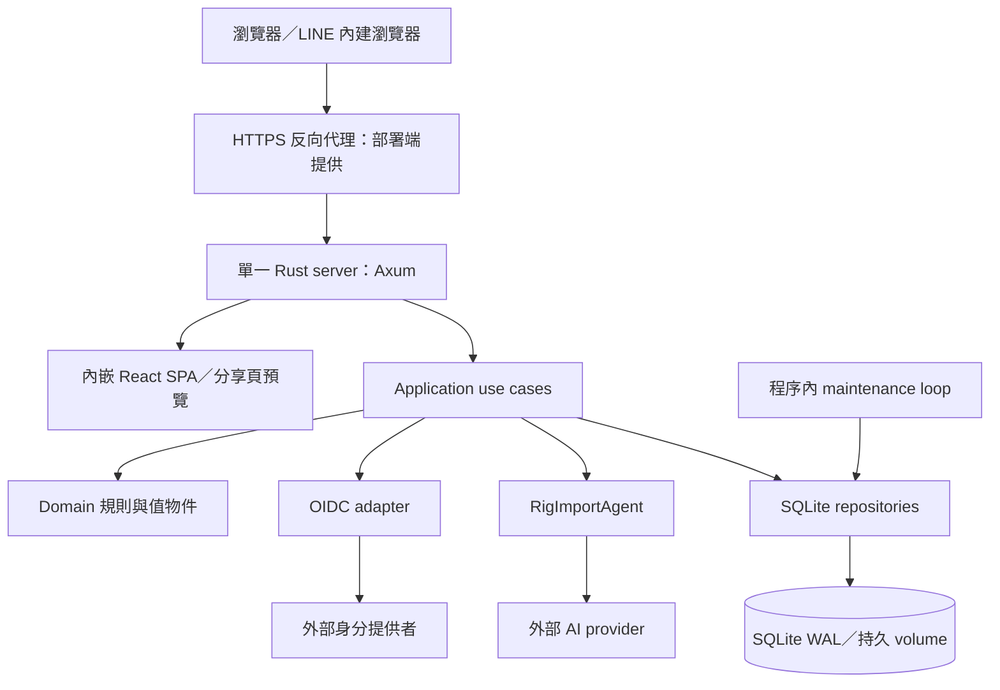

# 訂便當系統架構審查

> 審查日期：2026-11-04  
> 程式基準：`3887edef9dc4cbb406513318dcc429a366b7e3d1`（`main`）  
> 方法：以實際程式、migration、測試案例與 CI 定義進行靜態審查；設計文件只作輔助。本文不修改產品程式。

> 後續更新（2026-11-04）：`c499a31` 加上尚未提交的 A–G 工作目錄已完成對應改善及整合檢查，待主 agent 最終核准；未 commit／push／部署。見[施工與驗證紀錄](architecture-improvement-workplan.md)。本文以下發現仍保留 `3887edef` 審查時點，不改寫成施工後現況；R3 長任務與 R7 草稿格式等 H 類範圍仍未施工。

後續施工規格：[架構改善工作包](architecture-improvement-workplan.md)（含修改接點、相容性要求、測試矩陣與接手 agent 提示詞）。

## 一、結論摘要

**目前架構適合辦公室／社團訂餐這類單站、單實例的應用。建議保留模組化單體，優先補強 AI 成本控制、可觀測性與架構邊界，而不是拆成微服務。**

核心設計有幾個值得保留的優點：

- **部署簡單**：React 靜態檔嵌入 Rust binary，前後端同源，一個容器加一個 SQLite 持久 volume。
- **核心領域清楚**：主資料、開團快照、歷史送單、結算、AI 提案各有責任，不直接把畫面資料當正式帳務。
- **一致性設計扎實**：交易、送單冪等鍵、草稿 revision，以及正式匯入時重新驗證，能處理重送與競態。
- **AI 不直接寫正式店家**：先建立提案／草稿，由使用者確認後才在交易內套用。
- **測試層次完整**：領域測試、真實 SQLite 整合測試、AI wire mock、前端元件測試及 embedded binary E2E 都已具備。

最需要先處理的是：**初次 AI 匯入的每日配額檢查與建立作業分成兩次資料庫操作，存在併發超額的缺口。**其次是對話回合缺少持久化 token 用量，以及新功能逐漸繞過既有依賴／型別邊界。

### 改善優先順序

| 編號 | 優先級 | 發現 | 分類 |
|---|---|---|---|
| R1 | P1 | 初次 AI 匯入的每日配額檢查不是原子操作 | 可由程式路徑確認的競態缺口 |
| R2 | P2 | 對話修正沒有持久化每輪 token 用量，診斷事件也不足 | 成本追蹤與可觀測性缺口 |
| R3 | P2 | AI 執行依附長時間 HTTP 請求，沒有持久化執行佇列 | 現有可靠性／擴充限制 |
| R4 | P2 | 共用群組 HTTP handler 直接建立 SQLite repository | 架構邊界不一致 |
| R5 | P2 | 部分前端請求繞過 OpenAPI 型別化 client | 契約與 feature 耦合問題 |
| R6 | P2 | 設計／部署文件部分敘述已落後實作 | 維護與部署誤判風險 |
| R7 | P3 | 草稿 JSON 缺少獨立格式版本，部分狀態使用自由字串 | 後續演進成本 |
| R8 | P3 | CI 未完整檢查前端 lint 與生成型別檔是否已提交同步 | 自動化守門缺口 |

P1 表示建議下一輪優先修正；P2 表示近期改善；P3 表示隨相關功能演進處理。這是工作排序，不代表所有項目都是安全漏洞或阻擋目前部署。

## 二、系統全貌

### 2.1 執行架構



這是**模組化單體（modular monolith）**，不是微服務，也不是完整 event-sourcing 系統。送單採追加歷史紀錄，但其他資料仍是一般 CRUD／交易更新。

前後端雖在開發時可分別啟動，正式環境共用同一個 server。`/api/v1` 提供業務 API，`/auth` 處理登入，`/g/:token` 提供分享頁與預覽 metadata，其他頁面由 SPA 接手。

### 2.2 專案目錄

| 目錄 | 職責 |
|---|---|
| `backend/crates/domain` | 名稱、金額、狀態轉移、訂單與草稿規則 |
| `backend/crates/application` | 用例流程、權限協調、repository／agent 等 ports |
| `backend/crates/infrastructure` | SQLite、OIDC、Argon2、圖片處理、Rig 等實作 |
| `backend/crates/api` | HTTP DTO、extractor、錯誤映射、OpenAPI、靜態頁 |
| `backend/crates/server` | 環境設定、依賴組裝、啟動、maintenance、CLI、AI eval |
| `backend/migrations` | 內嵌於 binary 的資料庫版本變更，目前至 `0010` |
| `frontend/src/app` | Router、layout、全域 providers |
| `frontend/src/features` | 名單、店家、訂餐、共用群組、AI 匯入等功能 |
| `frontend/src/shared` | API 型別與 client、UI 元件、日期／金額等共用工具 |
| `e2e` | Playwright，連接真實 server 與獨立測試資料庫 |
| `eval` | 真實 AI 評測圖片與預期資料 |
| `spikes` | 獨立技術驗證程式，不是正式執行入口 |

## 三、後端分層與依賴方向

從各 crate 的 `Cargo.toml` 可確認目前內部依賴如下：

```text
domain          → 不依賴其他專案 crate
application     → domain
infrastructure  → application、domain
api             → application、domain、infrastructure
server          → api、application、domain、infrastructure
```

### 3.1 做得好的部分

1. **核心規則大致向內集中。**金額範圍、名稱正規化、訂單狀態及草稿操作有 domain 層，不散落在 React 表單或 SQL 中。
2. **外部能力透過 ports 替換。**`ImportAgent`、`Clock`、`TokenGenerator`、repository traits 讓測試能用 fake／固定時間，不必依賴真實 AI 或 OIDC。
3. **依賴組裝集中。**`server/src/wiring.rs` 組合設定、adapters 與 use cases，正式 server 與 AI eval 共用 Rig 設定。
4. **交易邊界考慮業務操作。**repository 不只暴露零散 CRUD；例如送單、匯入套用、群組修改都在交易內完成必要驗證與寫入。

### 3.2 分層不是完全一致

`api` 本身依賴 `infrastructure`，`AppState` 也持有具體 `Db`。健康檢查讀資料庫、HTTP 邊界做圖片正規化，可以視為務實選擇；較值得修正的是**業務 handler 直接建立 repository**，詳見 R4。

另外，domain 中的 AI proposal／draft 已使用 serde 與金額 JSON 轉換，所以它不是完全與序列化無關的「純領域模型」。目前沒有必要為了形式完全拆開；若外部 API 與內部持久化格式開始分歧，再拆獨立 DTO 比較有價值。

## 四、資料模型與核心流程

### 4.1 主資料與權限範圍

- `Roster`、`Vendor` 是可重用的主資料。
- `SharingGroup` 是共用資料的權限範圍，與一次訂餐的 `GroupOrder` 不同。
- 共用群組有本機管理的 admin／member 角色，不直接把 OIDC claims 當作該群組角色。
- 送餐地址目前是個人資料；AI 匯入服務明確拒絕把它放入共用 scope。

**建議保留這個區分**：資料共用權、開團管理權、持分享連結的參與權，不應混成一種「使用者權限」。

### 4.2 開團快照與送單歷史

```text
名單／店家菜單
    ↓ 開團時複製
participants／offered_items／店家資訊快照
    ↓ 參與者送出
order_submissions + submission_lines（追加紀錄）
    ↓ 取每人最新送出紀錄
有效訂單、公開總覽、管理統計
    ↓ 標記實收／領取
settlements
```

這樣能保證店家日後改價，不會重算已開團或歷史送單的價格。取消訂單使用空的最新送出紀錄，舊紀錄仍保留。

送單帶有冪等鍵，repository 在交易內處理重送與團狀態檢查。管理查詢使用專用 read model；公開總覽是精簡投影，不直接回傳管理端 DTO。這可視為**輕量讀寫分離**，不需要獨立資料庫或訊息匯流排。

主要依據：`application/src/ordering.rs`、`infrastructure/src/ordering_repo.rs`、`api/src/routes/public.rs`。

### 4.3 金額邊界

目前不是整元系統：

| 邊界 | 表示方式 | 例子 |
|---|---|---|
| Rust／SQLite | 整數分 | `750` 表示 7.5 元 |
| API／AI／proposal、draft JSON | 元的數字 | `7.5` 表示 7.5 元 |
| 前端輸入與顯示 | 使用者看到元；計算時換成整數分 | `7.5 × 3 = 22.5` |

`Money` 負責內部金額，`amount.rs` 與前端 `money.ts` 負責邊界轉換。避免直接以浮點數計算帳務，是正確方向。

`0010_money_cents.sql` 同步轉換菜單、開團快照、歷史成交價與已收款；JSON 維持元，不再乘 100。**升級後不能單獨降回舊 binary，必須恢復對應舊 DB。**這是實際的資料格式切換，不只是 UI 小數顯示功能。

### 4.4 AI 初次匯入

```text
上傳圖片 → 身分／scope／圖片驗證 → 配額檢查 → 建立 Running run
    → Rig agent 讀圖、呼叫受限 tools → Proposed 或 Failed
    → 使用者確認 → 重新驗證並在交易內套用 → Applied
```

Agent 透過 application 定義的 context／tools 讀取資料與提出變更；各模式只掛入相關工具。正式店家／名單不在模型回應當下直接更新。

目前支援四種設定：Anthropic、Anthropic-compatible、OpenAI-compatible、OpenAI Responses；Rig 固定官方 `0.46.0`。OpenCode Go 仍走 compatible provider，並未改接官方 Go 專用 client。

### 4.5 AI 草稿對話

這裡有兩種不同的「多輪」：

- **一次 agent 執行內的多輪**：模型呼叫 tools，再根據結果繼續推理。
- **使用者的多輪修正**：一次文字指示啟動一次 agent 執行，輸入最新草稿與近期對話。

目前對話不是無限保留的原生模型 chat session。`draft_service.rs` 每輪提供權威草稿、最近最多六輪歷史，以及尚有效的暫存原圖；草稿最多 20 輪、單次指示最多 500 字。

關鍵保護包括：

- stable draft IDs：AI 操作草稿列，而非任意正式資料 ID。
- revision CAS：等待模型期間若草稿已變更，舊結果不能直接覆蓋新版本。
- turn ID：同一輪重送不再次啟動模型與扣應用程式配額。
- pending 到期回收：卡住的回合可轉成失敗，不一直鎖住草稿。
- 單輪原子套用與 Undo：失敗保留原草稿；手改後停用舊 Undo，避免覆蓋新手改。
- 最終 apply 再次檢查 revision、scope、run 狀態及交易條件。

這套「可確認、可修正的草稿」比讓 AI 任意 CRUD 正式店家更合適。但**應用程式配額冪等不等於外部供應商帳單 exactly-once**；網路中斷與 agent 內部重試仍需獨立追蹤用量。

## 五、前端架構

React 19、React Router、TanStack Query、Vite、Tailwind 與 Base UI 組成 SPA。路由採 feature-level lazy loading，沒有額外引入全域狀態框架。

### 5.1 狀態分工

- **伺服器資料**：TanStack Query cache。
- **尚未送出的選餐／編輯草稿**：元件 state、ref 或 feature hook。
- **身分與團設定**：由後端回應決定，不以 localStorage 當作授權依據。
- **跨請求一致性**：公開訂餐 hooks 使用 AbortSignal、cancelQueries、invalidateQueries；撤權後阻擋晚回應重新填入 cache。

保留 tab 內的編輯器、成功後展示實際後端快照，以及截止後重新讀取已送出訂單，都是針對真實使用情境的合理設計。

### 5.2 維護壓力

`AiImportPage.tsx`、`OrderEditor.tsx`、`PublicOrderPage.tsx` 同時承擔表單、非同步操作、顯示模式與焦點處理。這不等於必須重寫，但下次新增流程時應優先抽出**可測的狀態轉移／feature hook**，避免繼續增加互相依賴的 boolean。

不建議只因檔案行數增加就引入大型狀態機套件；現有測試已經覆蓋不少競態，應在保留行為測試的前提下漸進整理。

型別化 API 的例外則是更直接的問題，詳見 R5。

## 六、權限、隱私與營運邊界

### 6.1 已存在的保護

- 開團者登入使用 server-side session；cookie 帶 HttpOnly、SameSite=Lax，HTTPS 設定下帶 Secure。
- 密碼使用 Argon2；OIDC adapter 處理外部身分驗證。
- 有 Origin 檢查；狀態變更請求若帶 Origin 必須在允許清單內，缺少 Origin 的非瀏覽器 client 仍可通行。
- 公開端點按 IP、AI 入口按開團者做程序內限流；代理 IP 只信任明確設定的 proxy。
- 分享 token 可輪替；HTTP log 隱藏分享路徑中的 token，不記 query string。
- 公開訂單總覽使用精簡 DTO，不回傳備註、實收或裝置資訊。

### 6.2 需要正確理解的產品限制

**持分享連結不是個人身分驗證。**參與者可以選名字，因此系統不能保證操作的人就是該名字本人；裝置資訊只能協助追查。

此外，「公開總覽不顯示備註」不代表所有持連結者都不能讀取備註：既有單人有效訂單 API 的 DTO 包含訂單／品項備註。若未來要求個人訂單真正私密，需要新增參與者授權設計，不能只隱藏 UI 欄位。

這是現行 capability URL 模型的邊界，不應在未改產品需求前，直接把免登入流程改成帳號系統。

### 6.3 SQLite 與單實例

`Db` 使用 WAL、單一 write connection、最多八條 read connections、foreign keys 與五秒 busy timeout。寫入流程常使用 `BEGIN IMMEDIATE`。

這個配置適合目前的部署方式，但：

- write pool 在單一程序中序列化寫入，不代表程序外其他 writer 也受它協調。
- `Db.read` 是以用途命名的 pool，並未設定 SQLite read-only；讀寫分工仍靠程式約定。
- 記憶體限流、maintenance loop 與 SQLite volume 都以單實例為前提，不能只增加容器副本就當作水平擴充。
- 圖片 BLOB 與歷史資料在同一 DB，會影響備份、WAL 大小及停機維護時間。

先量測 DB 寫入等待、資料量與備份時間，再決定是否需要 PostgreSQL 或外部圖片儲存；目前沒有量測證據支持立即遷移。

### 6.4 Logs、健康檢查與清理

目前使用 `tracing` 文字日誌輸出至 stdout，以 `RUST_LOG` 控制層級；HTTP span 記 method、遮罩後的 path，回應記 status 與 latency。尚未具備統一 request ID、JSON logging、metrics 或完整 audit event pipeline。

`/healthz` 在 read pool 執行 `SELECT 1`。它能確認程序與 DB 連線基本正常，**不保證磁碟可寫、AI 可用、備份有效或所有業務功能健康**。

Maintenance 在啟動後約 30 秒第一次執行，再依設定週期執行，處理 session、OAuth state、裝置資訊、卡住的初次匯入與暫存圖片。初次匯入超過十分鐘仍 Running 會被視為中斷；草稿 pending 則另由草稿讀取流程回收。

到期不可編輯／不可取圖，與資料實際刪除是不同概念。現有 maintenance 沒有整體刪除舊 AI 對話 JSON／usage ledger 的保留政策；資料量成長時應補明確期限，而不是假設 24 小時後所有紀錄都會消失。

## 七、具體審查發現與建議

### R1 — P1：初次 AI 匯入配額存在 check-then-act 競態

**證據**：[`service.rs:272–300`](../backend/crates/application/src/ai_import/service.rs#L272) 先 `count_since`，通過後才 `create`；[`ai_import_repo.rs:198–243`](../backend/crates/infrastructure/src/ai_import_repo.rs#L198) 的建立交易沒有再次檢查配額。

若剩一個名額，兩個並行請求可以先各自讀到尚未滿額，再依序建立 run。即使只有一條 write connection，也只會序列化建立動作，無法使前面的檢查一起變成原子操作。入口每分鐘限流降低頻率，但不能消除此競態。

相較之下，對話回合的 `save_draft(..., quota)` 已在 `BEGIN IMMEDIATE` 內計數並保留用量，兩條入口的保證不一致。

**建議**：將初次 run 的配額檢查與建立合併成一個 repository 操作，沿用同一個 24 小時用量口徑；不要只在 HTTP handler 加鎖。

**驗收方式**：剩一個名額時並行啟動兩個初次匯入，以及初次匯入與對話各一個；都應只有一個保留成功，失敗者不得呼叫模型。本次是靜態路徑確認，尚未新增併發重現測試。

### R2 — P2：對話成本與診斷資料不完整

**證據**：[`draft_service.rs:176–215`](../backend/crates/application/src/ai_import/draft_service.rs#L176) 成功時儲存 reply、changes、status，但未儲存 `AgentOutcome.usage` 或 context 累積 usage；[`DraftTurn`](../backend/crates/domain/src/ai_import/draft.rs#L34) 沒有用量欄位；[`0009`](../backend/migrations/0009_ai_import_drafts.sql) 的 `ai_import_turn_usage` 記的是次數與時間，不是 token 數。

初次匯入會保存 usage 與工具紀錄，後續修正沒有對等資料。因此既有 run usage 不能當成「整份匯入加全部對話」的完整成本。

**建議**：每輪記錄 run ID、turn ID、model、status、duration、input/output tokens、重試次數及簡化錯誤類別；用 run／turn 關聯 HTTP request。一般 log 不要直接加入完整圖片、prompt、工具參數或 API key。

**驗收方式**：成功、失敗、內部重試與同 turn ID 重送各有測試；重送不重複累加帳面用量，失敗前已消耗的 tokens 不遺失。先做結構化事件與持久化用量，再視需要加 metrics。

### R3 — P2：AI 作業依附長時間 HTTP 請求

**證據**：`start_import` 直接等待 `AiImportService::start`；對話也直接等待 `turn`。`run_agent` 在程序內 timeout／retry，沒有獨立持久化 worker。maintenance 對中斷 run 的處理是標失敗，不是續跑。

這能保持實作簡單，但代理 timeout、程序重啟或回應遺失時，使用者可能無法立刻知道執行結果。初次匯入也沒有像對話 turn ID 那樣的用戶端冪等入口；重新上傳可能建立另一個作業。

**近期建議**：明確對齊代理／client／server timeout，補初次匯入冪等鍵與可查詢 run 的恢復流程；增加全域或每使用者的 AI 在途數限制。現有圖片處理 semaphore 並不是 AI 網路執行的併發限制。

**需求成長後再做**：若要求關閉頁面仍可靠完成、重啟續跑，才改成 `202 + run ID + durable job`；以 SQLite job table 起步即可，不必直接引入 Redis 或訊息平台。

### R4 — P2：部分業務路徑繞過 composition root

**證據**：[`sharing_groups.rs:125–138`](../backend/crates/api/src/routes/sharing_groups.rs#L125) 在 handler 中呼叫 `SqliteSharingRepo::new(s.db)`，其他共用群組操作也採同樣模式；`AppState` 直接暴露 `Db`。

影響是共用群組流程與 SQLite 綁定，無法像其他 use cases 一樣從 wiring 注入替代實作；未來共用群組新增多步驟規則時，也容易繼續在 API／repository 之間分散責任。

**建議**：先把既有 `SharingRepo` trait object 由 wiring 注入 state；有跨 repository 的流程時再加薄的 `SharingService`。不必為健康檢查或每個簡單查詢都建立空轉 service。

### R5 — P2：前端有兩套 API 呼叫模式

**證據**：[`shared/api/client.ts`](../frontend/src/shared/api/client.ts) 使用 `createClient<paths>`；但 [`sharing-groups/hooks.ts:10–18`](../frontend/src/features/sharing-groups/hooks.ts#L10) 的 `sharingRequest<T>` 使用任意字串 path、`unknown` body 與呼叫者指定的回傳型別。AI 草稿等其他 feature 又匯入這個 helper。

`T` 在這裡是呼叫端宣告，不會驗證 endpoint 與 request／response 是否匹配，削弱既有 OpenAPI 生成的編譯期保護；通用 HTTP 能力放在某個 feature 也形成不必要的跨 feature 耦合。

**建議**：新端點優先使用既有 typed client，逐步遷移 sharing／draft；必要共用 transport 放回 `shared/api`，支援 AbortSignal。只搬動 generic helper 能改善位置，不能解決型別契約問題。

### R6 — P2：文件存在會影響決策的過時敘述

**證據**：`docs/design.md` 仍將 Money 描述為整數元（§4.4 值物件）、把多人共管列為 MVP 非目標（§1.3），流程圖仍使用 Google 專用登入路徑，另寫到 domain events 記錄於 log（§4.5）；實作已支援通用 OIDC、共用群組與整數分，未見完整對應的業務事件發送機制。

`docs/deploy.md` §9 仍概括描述 migration 為「向前相容」、停機約等於容器重啟時間；這不足以說明 `0010` 金額單位切換的回退限制與資料轉換時間。

**建議**：明確分成「目前實作」「歷史設計」「未來提案」，修正登入路徑、權限模型、Money、AI 對話與 migration 回退說明。部署文件應直接連到 `decimal-money.md`，避免只讀主部署步驟的人漏看。

### R7 — P3：草稿持久化格式與業務型別緊密綁定

**證據**：`ai_import_drafts.state_json` 直接序列化 `DraftState`；只有併發用的 `revision`，沒有格式 schema version。`DraftTurn.status` 使用 `String`，而非受限制的 enum。

目前規模小、資料有編輯期限，尚不需要事件儲存框架。但未來更動欄位、Undo 結構或狀態名稱時，要考慮 DB 內既有 JSON；編輯期限不等於資料已刪除。

**建議**：下一次變更此格式時採 `serde(default)` 等相容策略或明確 migration；必要時加入獨立 `schemaVersion`。`revision` 繼續只表示併發版本，不混用為格式版本。

### R8 — P3：CI 契約守門可以補齊

**證據**：`.github/workflows/ci.yml` 會比對重新輸出的 `openapi.json`，但前端執行 `npm run gen:api` 後，沒有再對 `schema.d.ts` 執行 `git diff --exit-code`；也沒有執行專案既有的 `npm run lint`。

這不代表 CI 使用舊型別：它會先生成再 typecheck。缺口是提交中的型別檔可能落後而 CI 仍通過，使直接使用 checkout 的開發者看到不同結果。

**建議**：在生成後增加型別檔差異檢查，加入 lint；若目前有既存 warnings，先定義基線，不把架構整理變成無關格式大改。

## 八、測試與發布評估

| 層次 | 現有機制 | 能證明什麼／限制 |
|---|---|---|
| Domain | 單元測試、部分 property tests | 規則、邊界、狀態轉移；不能取代 DB 交易測試 |
| Infrastructure／API | 暫存 SQLite、實際 repositories、Axum 測試 | migration、權限、交易、HTTP 契約 |
| AI adapter | 本機 mock provider | 圖片 wire 格式、多輪 tools、token 設定、錯誤映射；不代表模型語意品質 |
| Frontend | Vitest、Testing Library、MSW | 元件互動、錯誤、cache／晚回應處理 |
| E2E | embedded server + Chromium 手機／桌面 | 整合流程與 layout；手機 viewport／LINE UA 不等於真實 iOS WebView |
| 真實 AI | `make ai-eval`，手動執行 | 模型辨識與工具效果，會消耗額度，不納入一般 CI |

CI 依序完成後端／前端、E2E，再建置發布 amd64／arm64 image，這個發布閘門合理。Docker runtime 使用非 root 使用者與持久 volume，也有基本健康檢查。

目前 CI 的 Rust toolchain 是 `stable`，Docker builder 使用 `rust:1-bookworm`；Cargo lock 有固定依賴，但工具鏈與基底標籤仍會移動。若未來需要嚴格重現歷史 image，應固定 toolchain／基底版本或 digest，這不是現在必須先完成的大改。

本次沒有重新執行整套測試，也沒有以測試數量作為「架構無缺陷」的保證。前述配額競態就是既有大量成功測試仍可能漏掉的跨操作問題。

## 九、建議執行順序

### 第一階段：修正可直接影響成本與維運的缺口

1. R1：原子化初次匯入的配額保留，補初次／對話混合併發測試。
2. R2：保存對話回合用量，建立 request／run／turn 的關聯紀錄。
3. R6：同步金額 migration、共用權限及登入方式文件。

### 第二階段：恢復既有架構的一致性

1. R4：共用群組 repository 改由 wiring 注入。
2. R5：sharing／draft 呼叫逐步回到型別化 API client。
3. R8：補生成型別差異檢查與 lint。
4. R3 近期項目：初次匯入冪等與恢復查詢、AI 在途限制。

### 第三階段：由實際需求／量測決定

- 要求重啟續跑：才加入持久化 AI jobs。
- 寫入等待、備份時間或資料量成為瓶頸：才評估 DB／圖片儲存拆分。
- 要求真正個人訂單隱私：先定義參與者認證方式，再調整 API 權限。
- 草稿格式擴充：一併處理 JSON 版本與歷史資料相容。

**目前不建議**僅為「架構完整」導入微服務、Kafka、Redis、全域前端 store 或通用工作流引擎。先把現有單體內的邊界與一致性補齊，投入與回報更合理。

## 十、審查範圍與查閱入口

本次檢視實際來源、依賴方向、主要讀寫／授權流程、AI 執行與草稿保存、資料格式轉換、前端狀態、CI 與 Docker。**未進行正式環境負載測試、滲透測試、備份還原演練、真模型呼叫或新版本部署；未讀取實際 `.env`／API key。**R1 需要後續併發回歸測試，其他推論也不應當成正式環境事故紀錄。

後續維護可從以下位置進入：

- 組裝與設定：[`wiring.rs`](../backend/crates/server/src/wiring.rs)、[`config.rs`](../backend/crates/server/src/config.rs)、[`main.rs`](../backend/crates/server/src/main.rs)。
- API 與授權：[`api/src/lib.rs`](../backend/crates/api/src/lib.rs)、[`session.rs`](../backend/crates/api/src/session.rs)、[`client.rs`](../backend/crates/api/src/client.rs)。
- Ports 與訂餐：[`ports.rs`](../backend/crates/application/src/ports.rs)、[`ordering.rs`](../backend/crates/application/src/ordering.rs)、[`ordering_repo.rs`](../backend/crates/infrastructure/src/ordering_repo.rs)。
- AI：[`service.rs`](../backend/crates/application/src/ai_import/service.rs)、[`draft_service.rs`](../backend/crates/application/src/ai_import/draft_service.rs)、[`rig_agent.rs`](../backend/crates/infrastructure/src/ai/rig_agent.rs)、[`ai_import_repo.rs`](../backend/crates/infrastructure/src/ai_import_repo.rs)。
- 金額：[`money.rs`](../backend/crates/domain/src/shared/money.rs)、[`amount.rs`](../backend/crates/domain/src/shared/amount.rs)、[`decimal-money.md`](decimal-money.md)。
- 前端：[`router.tsx`](../frontend/src/app/router.tsx)、[`public-order/hooks.ts`](../frontend/src/features/public-order/hooks.ts)、[`ai-import/draft.tsx`](../frontend/src/features/ai-import/draft.tsx)。
- 維運：[`logging.rs`](../backend/crates/api/src/logging.rs)、[`sqlite.rs`](../backend/crates/infrastructure/src/sqlite.rs)、[`maintenance.rs`](../backend/crates/application/src/maintenance.rs)、[`deploy.md`](deploy.md)、[`ci.yml`](../.github/workflows/ci.yml)。

**總評：核心訂單與草稿的一致性設計值得保留；下一步應從「功能能完成」提升到「成本可控、問題可追、邊界一致、文件可信」。**
